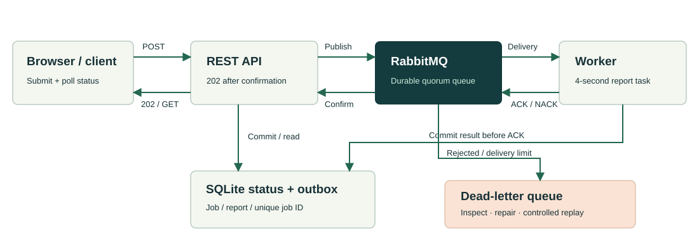

# Week 06 · Asynchronous Report Jobs

FastAPI accepts report requests, RabbitMQ buffers durable messages, and a
**separate worker process** generates reports after four seconds. The dashboard
polls for status. No paid service or API key is needed.

## Start on Windows (Docker Desktop)

Extract the ZIP. Open PowerShell **inside the extracted folder containing
docker-compose.yml**. Start Docker Desktop and wait for its Linux engine.

~~~powershell
docker compose up --build -d
docker compose ps
~~~

The first build can take several minutes. Wait for a healthy API and running
worker. Open:

- **Dashboard:** http://localhost:8006
- **API docs:** http://localhost:8006/docs
- **Architecture diagram:** http://localhost:8006/architecture
- **RabbitMQ management:** http://localhost:15672
  - User: classroom
  - Password: classroom-local-only

These are local demo credentials, not an API key. Services bind to localhost.
Port **8006** avoids conflict with Week 5 on port 8000.

In another PowerShell window, inside the same folder:

~~~powershell
docker compose logs -f api worker
~~~

Ctrl+C stops following logs, not the containers.

### Submit and poll with PowerShell 5.1

~~~powershell
$body = @{title="Weekly summary"; duration=4; mode="normal"} | ConvertTo-Json
$key = [guid]::NewGuid().ToString()
$response = Invoke-WebRequest -UseBasicParsing -Uri "http://localhost:8006/api/jobs" -Method Post -ContentType "application/json" -Headers @{"Idempotency-Key"=$key} -Body $body
$response.StatusCode
$response.Headers["X-Response-Time-Ms"]
$job = $response.Content | ConvertFrom-Json
Invoke-RestMethod "http://localhost:8006/api/jobs/$($job.id)"
~~~

Repeat the final GET. The POST returns **202** after broker confirmation,
without waiting four seconds for the report. The timing header measures server
handling, not the browser round trip. Verify the assignment's <100 ms target
on your laptop; do not assume it passes.

## Architecture and data flow

~~~mermaid
flowchart TD
    Client["Browser / REST client"] -->|"POST job"| API["FastAPI producer"]
    API -->|"Job + outbox transaction"| DB["SQLite status / reports / outbox"]
    API -->|"Persistent publish + confirm"| Broker["RabbitMQ jobs queue"]
    Broker -->|"Manual-ACK delivery"| Worker["Separate worker"]
    Worker -->|"Commit report + status"| DB
    Worker -->|"ACK / bounded NACK"| Broker
    Broker -->|"Poison or delivery limit"| DLQ["Dead-letter queue"]
    Client -->|"GET status every second"| API
    API -->|"Read current status"| DB
~~~

The outbox relay thread only retries publication. It never generates reports.

## Messaging guarantees and boundaries

- **Durability:** quorum work queue and DLQ, persistent messages, mandatory
  routing, publisher confirms, and a named broker volume.
- **ACK:** auto_ack=False. The worker ACKs after committing the report and
  completed status. Prefetch one bounds in-flight deliveries.
- **Crash recovery:** RabbitMQ can redeliver unacknowledged work on connection
  loss. A job can remain processing until the worker returns.
- **Idempotency:** reports.job_id is a primary key. Report insertion and terminal
  status share a transaction. Redelivery skips completed work. This protects
  this local DB effect, not arbitrary external emails or payments.
- **Retries:** retry_once simulates one transient error, waits two seconds, and
  NACKs with requeue. A persistent attempt counter bounds processing to three
  attempts. A broker delivery limit of 20 also bounds repeated worker crashes.
- **DLQ:** poison simulates unprocessable work. The worker records failed and
  NACKs without requeue. RabbitMQ dead-letters it. Malformed/unknown envelopes
  also go to the DLQ. Quorum at-least-once dead-lettering uses reject-publish
  overflow. Inspect and repair before replay; failed job IDs do not restart
  automatically.
- **Dual writes:** a job and its outbox entry commit together. After broker
  confirmation, the publisher marks the entry sent. A crash in that gap can
  publish duplicates, which the consumer tolerates. Publication failure returns
  **503 with the saved job ID**; the relay retries after connectivity returns.
  A lost response is uncertain: reuse the same Idempotency-Key and payload.
- **Ordering:** one worker consumes serially, but retries, requeues, and multiple
  workers do not provide global FIFO.
- **Scope:** one RabbitMQ node has restart persistence, not multi-node HA.
  SQLite is a local shared Docker volume, not a cross-host status service.
  Authentication, TLS, admission quotas, scheduled retry queues, external
  side-effect reconciliation and metrics export are future production work.

Queue arguments are explicit for this local exercise. Mutable broker policies
are preferable for production dead-letter configuration.

## QA and video

See [DEMO.md](DEMO.md) for narration and [docs/QA.md](docs/QA.md) for evidence.

~~~powershell
docker compose exec api python -m pytest -q
docker compose exec api python scripts/audit_ack.py
~~~

Optional automated **live** checks, from PowerShell inside this folder:

~~~powershell
powershell -NoProfile -ExecutionPolicy Bypass -File .\scripts\qa.ps1
~~~

The policy change applies only to that child process. The script creates jobs,
stops this project's worker during work, submits two more, restarts it in a
finally block, and checks recovery. It saves qa-live-results.json. It measures
latency and triggers retry and poison scenarios. Browser DevTools and DLQ
inspection remain manual. Read results before marking checks complete.

### Manual burst and crash demo

1. Click **Queue 5 reports** on the dashboard.
2. In RabbitMQ **Queues and Streams**, open week06.jobs. Observe Ready/Unacked.
3. While a job says processing:

~~~powershell
docker compose stop -t 0 worker
~~~

4. Submit two more jobs. They should receive 202 and remain queued.
5. Show the queue, then restart:

~~~powershell
docker compose start worker
docker compose exec rabbitmq rabbitmqctl list_queues name messages_ready messages_unacknowledged
~~~

6. Watch the original IDs complete and ACK logs appear. A worker killed after
   commit may already have completed; redelivery should skip the duplicate.

Select **Poison payload** or **Transient error** for additional failure demos.
Inspect week06.jobs.dlq in management. Avoid destructive Get/purge operations
on the work queue during recording.

### Stop / restart

~~~powershell
docker compose down
docker compose up -d
~~~

Named volumes remain. Adding -v to down deliberately erases this demo's data.

### Troubleshooting

- **dockerDesktopLinuxEngine / pipe not found:** open Docker Desktop and wait.
- **Docker missing:** install Docker Desktop and enable Linux containers.
- **Port already allocated:** check other services on 8006, 5672 or 15672.
- **Processing stuck:** check docker compose ps and worker logs; restart worker.
- **503:** use the returned job ID to check status. Outbox retry may recover it.
- **>100 ms:** measure honestly. Inspect warmup, disk pressure, CPU and broker
  confirmation latency before retesting.
- **OneDrive:** the Docker route needs no local uv/venv and avoids the Week 5
  hardlink installation issue.

## Optional host-Python development

Run only RabbitMQ in Docker. Do not also run Docker API/worker simultaneously.

~~~powershell
$env:UV_LINK_MODE = "copy"
uv sync --locked
docker compose up -d rabbitmq
uv run python -m uvicorn src.api:create_app --factory --host 127.0.0.1 --port 8006
~~~

Second terminal, same folder:

~~~powershell
$env:UV_LINK_MODE = "copy"
uv run python -m src.worker
~~~

Both use data/jobs.db and the default local broker URL. Host data is separate
from the Docker job-data volume.

## AI disclosure

ChatGPT generated the code, audited it, corrected an auto-ack draft, and ran
the automated tests. The student must review and run it locally, verify actual
RabbitMQ behavior, publish their own repository, and record the presentation.
See [ai_prompt_log.md](ai_prompt_log.md). No unperformed manual work is attributed
to the student.

## References

- [RabbitMQ confirms](https://www.rabbitmq.com/docs/confirms)
- [Dead-letter exchanges](https://www.rabbitmq.com/docs/dlx)
- [Quorum queues](https://www.rabbitmq.com/docs/quorum-queues)
- [Pika BlockingConnection](https://pika.readthedocs.io/en/stable/modules/adapters/blocking.html)
